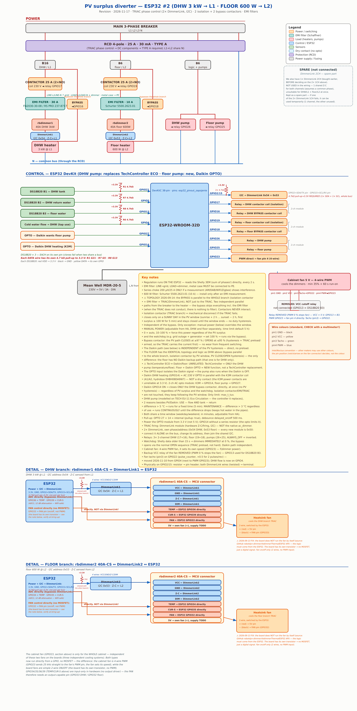
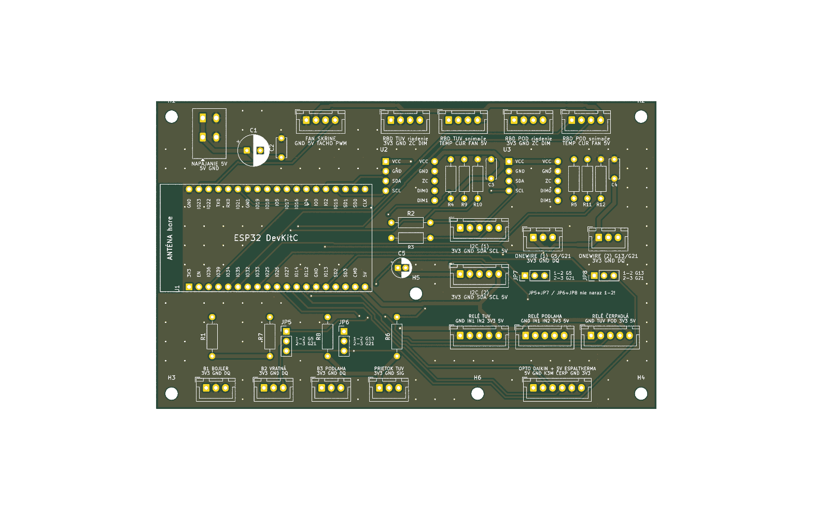

# FVE diverter — solar surplus diverter for a Daikin heat-pump house (ESPHome + Home Assistant)

*[Slovenská verzia → README.sk.md](README.sk.md)*

An ESP32 (ESPHome) that sends **solar PV surplus into two electric heaters**: the domestic
hot water tank (3 kW element) and the underfloor heating water (~600 W element). Each heater is
driven by a TRIAC board controlled over I2C. Unlike a plain "keep the grid at 0 W" router, it
works with the **battery of a hybrid inverter (charging power and state of charge, SoC)** and with the **Daikin Altherma heat pump**. A set
of Home Assistant packages makes the slower decisions: when to turn the heat pump down because
the sun heats the house, when the heat pump must not heat the hot water because the sun will,
and a weekly heating plan with a custom Lovelace card.

It runs at home since 2026-11-15. The **PCB is designed and ordered but not built yet**
(see [PCB](#pcb--carrier-board) below).



*Main schematic: [SVG](docs/schematics/fve_schema_en.svg) · [PNG](docs/schematics/fve_schema_en.png) (Slovak original: [`fve_schema.svg`](docs/schematics/fve_schema.svg)).*

> Code comments and most of the docs in `docs/` are in **Slovak**. Entity names in Home Assistant
> are Slovak too (e.g. *TUV* = domestic hot water, *podlaha* = underfloor heating,
> *čerpadlo* = pump, *stykač* = contactor, *prebytok* = surplus, *okno FVE* = PV window).

## What it does

**ESP32 firmware** ([`esphome/fve-diverter.yaml`](esphome/fve-diverter.yaml)) — works without
Home Assistant too:

- **Measurement:** a Shelly 3EM-63 Gen3 at the grid connection is read directly by the ESP every
  2 s (local HTTP RPC). Battery power and SoC of the Solax hybrid inverter come from the Solax
  Cloud API through Home Assistant (about every 4 min).
- **How the surplus is split:** the floor first (0–600 W), then hot water and battery ¾ : ¼. The
  battery always keeps a 300 W reserve. At SoC ≥ 97 % everything goes to the hot water.
  - From the Shelly reading: when power is drawn from the grid, the heaters are cut quickly; when
    power flows out to the grid, they get more.
  - Each new Solax reading moves the heaters toward the target, taking into account what the
    heaters drew at the time of that reading.
- **Battery-aware (SoC):** unlike grid-only routers, it knows how much the battery is charging
  and its state of charge.
  - The battery gets its share first (300 W reserve, ¼ of the surplus above the floor element;
    the share is adjustable).
  - Once the battery counts as full (SoC ≥ 97 %, adjustable), the whole surplus goes to the hot
    water.
  - A weak Solcast forecast for tomorrow can raise the inverter's minimum SoC as a backup reserve
    (waits for a local Solax dongle).
- **Fail-safe:** no Shelly data for more than 15 s → heaters at 0 W. If Solax or HA is
  unavailable, an emergency Shelly-only mode heats only from the visible export and keeps about
  300 W of it.
- **TRIAC + contactors:** an isolation contactor in front of each TRIAC and a bypass contactor
  that takes over at ≥ 97 % power and opens again at ≤ 95 %. The TRIAC is held at 100 % before
  the bypass closes, so the contacts don't arc. At most one relay switches per 5 s cycle.
- **Phase-angle control** through DimmerLink: LINEAR curve plus a power → level table measured
  with the Shelly (error ≤ 1.5 %).
- **PV window from sunrise/sunset:** the window runs from sunrise + 2 h to sunset − 2 h. It is
  computed on the ESP with the ESPHome `sun:` component, and both offsets are adjustable.
  - Inside the window, the first surplus of at least 100 W lasting 5 min starts a **"sunny
    day"**. Only then do the contactors close, and they stay closed until the window ends.
  - On a cloudy day nothing switches at all.
  - The house sits in a valley: the history showed direct sun on the panels starts 2 h 40 min to
    3 h after sunrise and ends 2 h 15 min to 2 h 30 min before sunset.
- **Daikin integration via two 230 V AC opto inputs:**
  - Coil of the hydrobox **K3M** contactor (booster heater request) → the shared hot-water
    element runs at full power through the bypass, no matter what the PV is doing.
  - Floor pump request → floor circulation pump.
- **Limits:** hot water max 75 °C and floor water max 35 °C (adjustable, 2 °C hysteresis).
  - A failed DS18B20 (NaN) means no heating from PV.
  - TRIAC temperature is measured with an NTC.
- **Manual power** per heater, with a time limit (default 5 h) and a notification when it
  expires. After a reboot the ESP always returns to automatic mode.
- **Pumps:**
  - Floor pump: Auto (Daikin / PV heating) / always on / OFF.
  - Hot water circulation pump runs on tap use (flow meter), maintenance, during heating, and when
    the tank is hot while the sun shines.
  - Both pumps have a **hard OFF/ON mode for service** that overrides everything.
- **Fans:** 4-pin PWM cabinet fan with tachometer, following the TRIAC load; fans on the dimmer
  boards.
- **Energy counters (estimated):** hot water from PV, floor, and hot water via Daikin K3M.
  - The K3M energy is split into *from grid* / *from sun* using the Shelly: from grid = current
    grid import, at most the element power.
  - Daily and lifetime totals are kept on the ESP; weekly and monthly totals are utility meters
    in HA.
- **Diagnostics:** the reason for every regulation step, the measurement age, read-back from the
  DimmerLinks and more, all sent through HA to InfluxDB.

**Home Assistant** ([`home-assistant/`](home-assistant)):

- [`packages/fve_strategia.yaml`](home-assistant/packages/fve_strategia.yaml) — strategy:
  - **Daikin heating:** −10 °C water offset when it is a *sunny day* and the surplus is ≥ 700 W.
    At least 30 min between changes protects the compressor. On days without sun the heating plan
    runs untouched.
  - **Daikin hot water blocked so the sun can heat it:**
    - workdays 06:00–15:00;
    - days off: from the start of the PV window, released for the whole day if no sunny day
      starts within 60 min;
    - vacation: blocked all the time;
    - a manually started Daikin *performance* run always wins: it is never interrupted, and
      blocking is skipped for the rest of that day.
  - Tech M-9R zones +2 °C while the floor element runs at full power.
  - Hot water circulation during heating when somebody is at home.
  - Solcast forecast → Solax minimum SoC (waits for a local Solax dongle).
- [`packages/fve_energia.yaml`](home-assistant/packages/fve_energia.yaml) — weekly and monthly
  energy totals.
- **Heating plan:**
  - [`packages/daikin_plan_kurenia.yaml`](home-assistant/packages/daikin_plan_kurenia.yaml) — a
    weekly plan that switches between normal and setback by changing the water temperature offset
    on the Daikin.
  - It uses a week schedule plus a holiday schedule, Slovak public holidays (Workday + Holiday
    integrations), school holidays and vacation.
  - It produces one target-offset sensor; the sun-driven reduction from the strategy has priority.
  - Card [`www/plan-kurenia-card.js`](home-assistant/www/plan-kurenia-card.js) with dashboard
    [`dashboards/plan_kurenia.yaml`](home-assistant/dashboards/plan_kurenia.yaml): a weekly
    editor, today's plan, holiday list with on/off toggles, and a strip showing when the sun
    (PV strategy) and the low-tariff signal (HDO) were active.
- Dashboards: [`fve_diverter.yaml`](home-assistant/dashboards/fve_diverter.yaml) (operation),
  [`fve_diverter_test.yaml`](home-assistant/dashboards/fve_diverter_test.yaml) (service firmware).
- [`solax/`](home-assistant/solax) — Solax Cloud API v2 `command_line` sensor + script (until a
  local dongle is used).
- [`automations/`](home-assistant/automations) — notification when manual power expires.

**Grafana** ([`grafana/`](grafana)) — generator of a dashboard showing energy into the heaters
per day and power over time (InfluxDB v2 / Flux, data written by the HA InfluxDB integration).

## Hardware it was built and tested with

| Part | Used here | Notes |
|---|---|---|
| Controller | ESP32 DevKit 38-pin, ESPHome **2026.10.2** (Arduino framework) | pin map in [`esphome/README.md`](esphome/README.md) |
| TRIAC boards | 2× **RBDimmer** (rbdimmer.com) + 2× **DimmerLink** (I2C, 0x54 / 0x53) | modified DimmerLink component in [`esphome/components/dimmerlink`](esphome/components/dimmerlink) |
| Grid meter | **Shelly 3EM-63 Gen3** (`/rpc/EM.GetStatus`) | other Gen2+ Shelly EMs with the same RPC should work |
| Inverter | **Solax** hybrid with battery, Solax Cloud API v2 | without it: emergency Shelly-only mode |
| Heat pump | **Daikin Altherma 3** hydrobox EHBH08DA9W7 (K3M contactor = booster heater) | opto inputs on the K3M coil and the floor pump request |
| HA integrations | Home Assistant 2026.11, packages, `schedule`, Workday, Holiday; custom [`daikin_altherma`](https://github.com/tadasdanielius/daikin_altherma) (local LAN adapter) for the heating plan | Solcast, Tech controllers and ESPAltherma are optional |
| Other | DS18B20 ×3, 2-ch 230 V AC opto module, 2-ch relay modules, contactors, Hall flow meter, Mean Well MDR-20-5, 4-pin PWM fan | |

Adapt before use:
- the substitutions at the top of `fve-diverter.yaml`: `shelly_ip`, `latitude`, `longitude`;
- `secrets.yaml` (copy it from `secrets.yaml.example`);
- the element powers (calibrate with the Shelly);
- the DS18B20 addresses;
- the entity names in the HA packages (Daikin, Tech, Solax, notify).

## PCB — carrier board

[`pcb/`](pcb) — KiCad 9 project for a carrier board. The ESP32 and both DimmerLinks plug into
socket headers, and all wiring goes to locking JST-XH connectors. The board carries only 5 V and
3.3 V. The board is **generated by a Python script** (`gen_doska.py`), routed with Freerouting
(`route.py`) and gets GND stitching vias (`prechodky.py`). Gerbers are in `pcb/vyroba/`.



> ⚠️ **Rev B is ordered but not assembled or tested yet.** The header footprints of the ESP32 and
> the DimmerLink still need to be checked against real parts.
>
> ⚠️ **The resistors for the CUR-S current sense inputs (R9–R12) are not decided yet.** The
> output voltage of the RBDimmer CUR-S sensor is not specified by the manufacturer and we have
> not measured it yet. Leave **R9/R11 unpopulated** until it is measured:
> - 3.3 V output → 0 Ω for R9/R11, no R10/R12;
> - 5 V output → a divider (proposed 10 kΩ / 18 kΩ, not verified yet).
>
> The firmware only displays CUR-S as a voltage; it is not used for regulation. Details:
> [`pcb/README.md`](pcb/README.md), [`docs/MERANIE_rbdimmer.md`](docs/MERANIE_rbdimmer.md).

## Repository layout

```
esphome/          ESPHome firmware (production + service/test version), DimmerLink component
home-assistant/   packages, dashboards, plan card (www), Solax cloud sensor, automation
grafana/          Grafana dashboard generator
pcb/              KiCad carrier board, generator scripts, gerbers, BOM (TME)
docs/             schematics (SVG/PNG + generators), dimmer calibration, measurements,
                  comparison with YaSolR, rbAmp power measurement plan
```

## Installation (short)

1. **Firmware:** `cd esphome`, `cp secrets.yaml.example secrets.yaml`, edit the substitutions,
   then `esphome run fve-diverter.yaml` (USB the first time, OTA after that). For bring-up, start
   with `fve-diverter-test.yaml`: nothing runs automatically there and everything is switched by
   hand from the service dashboard.
2. **HA packages:** set `homeassistant: packages: !include_dir_named packages`, copy
   `home-assistant/packages/*.yaml` to `/config/packages/`, restart HA, then run
   `script.fve_strategia_predvolene_hodnoty` once (default values of the helpers).
3. **Plan card:** copy `plan-kurenia-card.js` to `/config/www/`, add it as a resource
   `/local/plan-kurenia-card.js` (JavaScript module) and create a dashboard from
   `dashboards/plan_kurenia.yaml`.
4. **Solax cloud:** see [`home-assistant/solax/command_line.yaml`](home-assistant/solax/command_line.yaml).

## Status and known limitations

- The power going into the heaters is an **estimate** (dimmer level × calibrated element
  power), not a measurement. Measuring it with rbAmp modules is planned
  ([`docs/rbAmp_meranie_vykonu.md`](docs/rbAmp_meranie_vykonu.md)).
- Until a local Solax dongle is installed, battery data come from the cloud and are 1–5 min old.
  When it gets cloudy, the inverter can cover the heaters from the battery for a short while.
  The 300 W battery reserve limits this.
- Phase-angle control only (no cycle stealing); an EMI filter is used on the hot-water branch.

## Safety

This controls **230/400 V loads and contactors**. Build it only if you are qualified to do
mains wiring. It must have independent protection that does not depend on the ESP: an RCD, a
fuse or breaker per heater, a mechanical thermostat or thermal cut-out on every heater, and an
isolation contactor in front of each TRIAC (a failed TRIAC usually stays shorted). A "hard
OFF" in the software is not an isolation: always switch the breaker off before touching the
wiring.

## Credits

- **[RBDimmer / RobotDyn](https://rbdimmer.com)** — RBDimmer TRIAC boards and **DimmerLink**.
  The ESPHome component in `esphome/components/dimmerlink` is a modified copy of
  [robotdyn-dimmer/DimmerLink](https://github.com/robotdyn-dimmer/DimmerLink) (© 2024 RBDimmer,
  MIT); the change (register read-back fix) is described in
  [`NOTICE.md`](esphome/components/dimmerlink/NOTICE.md).
- **[YaSolR](https://github.com/mathieucarbou/YaSolR)** by Mathieu Carbou — a well-known
  open-source solar router. It was used for comparison and ideas (e.g. the time limit for manual
  mode, the PI regulator plans); no code was copied. See
  [`docs/porovnanie_yasolr_fve_diverter.md`](docs/porovnanie_yasolr_fve_diverter.md).
- **[ESPHome](https://esphome.io)** and **[Home Assistant](https://www.home-assistant.io)**.
- **[daikin_altherma](https://github.com/tadasdanielius/daikin_altherma)** by Tadas Danielius —
  local Daikin integration used by the heating plan.
- **[ESPAltherma](https://github.com/raomin/ESPAltherma)** by raomin — Daikin data incl. the
  low-tariff (HDO) signal shown on the plan card (optional).
- **[Solcast PV Forecast](https://github.com/BJReplay/ha-solcast-solar)** integration (optional),
  **Shelly**, **Solax Cloud API**.
- **[KiCad](https://www.kicad.org)** and **[Freerouting](https://github.com/freerouting/freerouting)**
  for the PCB.
- Designed and built by **kolumbus120**, with **[Claude Code](https://claude.com/claude-code)**
  (Anthropic) as an AI pair programmer for firmware, HA configuration, PCB scripts and docs.

## License

**GPL-3.0** — see [`LICENSE`](LICENSE). This applies to the firmware, Home Assistant
configuration, scripts, documentation and the PCB design. Exception:
`esphome/components/dimmerlink/` stays under its original **MIT** license.
