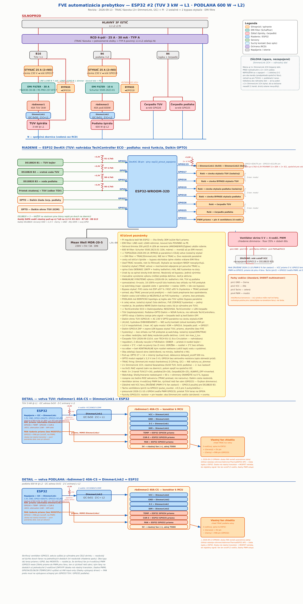
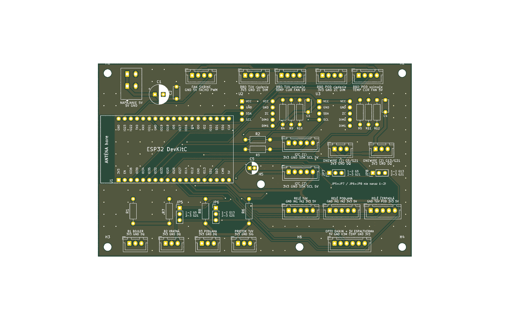

# FVE diverter — prebytok FVE do špirál v dome s tepelným čerpadlom Daikin (ESPHome + Home Assistant)

*[English version → README.md](README.md)*

ESP32 (ESPHome) posiela **prebytok z fotovoltiky do dvoch elektrických špirál**: do bojlera TUV
(špirála 3 kW) a do vody podlahového kúrenia (špirála ~600 W). Každú špirálu riadi TRIAC doska
cez I2C. Nie je to obyčajný „router na nulu na prípojke“: počíta s **batériou hybridného
meniča (nabíjanie aj stav nabitia, SoC)** aj s **tepelným čerpadlom Daikin Altherma**. Pomalšie rozhodnutia robí Home Assistant:
kedy znížiť Daikin, lebo dom hreje slnko, kedy Daikin nemá ohrievať TUV, lebo ju ohreje slnko,
a týždenný plán kúrenia s vlastnou kartou.

Doma beží od 15. 11. 2026. **Doska plošných spojov je navrhnutá a objednaná, ale ešte nie je
osadená** (viď [Doska](#doska-plošných-spojov) nižšie).



*Hlavná schéma: [SVG](docs/schematics/fve_schema.svg) · [PNG](docs/schematics/fve_schema.png) · anglická verzia [SVG](docs/schematics/fve_schema_en.svg) / [PNG](docs/schematics/fve_schema_en.png).*

## Čo to robí

**Firmvér ESP32** ([`esphome/fve-diverter.yaml`](esphome/fve-diverter.yaml)) funguje aj bez Home
Assistanta:

- **Meranie:** ESP číta Shelly 3EM-63 Gen3 na prípojke priamo každé 2 s (lokálne HTTP RPC).
  Výkon a SoC batérie zo Solax hybridu prichádzajú zo Solax Cloud API cez HA (asi každé 4 min).
- **Rozdelenie prebytku:** najprv podlaha (0–600 W), potom TUV a batéria v pomere ¾ : ¼.
  Batéria si vždy nechá rezervu 300 W. Pri SoC ≥ 97 % ide všetko do TUV.
  - Podľa Shelly: keď sa odoberá zo siete, výkon špirál sa rýchlo uberie; keď ide pretok do
    siete, pridá sa.
  - Pri každom novom údaji zo Solaxu sa výkon nastaví podľa cieľa. Počíta sa s tým, koľko špirály
    brali v čase toho merania.
- **Batéria a SoC:** na rozdiel od routerov, ktoré vidia len sieť, vie, koľko sa nabíja batéria
  a aký má stav nabitia.
  - Batéria dostane svoj podiel prednostne (rezerva 300 W, ¼ prebytku nad podlahou; podiel sa
    dá nastaviť).
  - Keď sa batéria považuje za plnú (SoC ≥ 97 %, nastaviteľné), ide celý prebytok do TUV.
  - Pri slabej predpovedi Solcast na zajtra sa môže zvýšiť minimálne SoC meniča ako záloha
    (čaká na lokálny Solax dongl).
- **Ochrana pri výpadku:** údaj zo Shelly starší ako 15 s → výkon 0 W. Keď nejde Solax alebo HA,
  beží núdzový režim len zo Shelly: hreje len z viditeľného pretoku a drží asi 300 W pretok.
- **TRIAC a stykače:** pred každým TRIAC-om je izolačný stykač. Bypass stykač preberá prúd pri
  výkone ≥ 97 % a rozopne pri ≤ 95 %. Pred zopnutím bypassu je TRIAC 1 cyklus na 100 %, aby
  kontakty neiskrili. Za jeden 5 s cyklus sa prepne najviac jedno relé.
- **Fázové riadenie** cez DimmerLink: krivka LINEAR a prepočet výkonu na úroveň podľa tabuľky
  zmeranej so Shelly (odchýlka do 1,5 %).
- **Okno FVE podľa slnka:** okno trvá od východu + 2 h po západ − 2 h. Počíta ho ESP komponentom
  `sun:` a oba posuny sa dajú nastaviť.
  - Prvý prebytok aspoň 100 W, ktorý v okne trvá 5 min, začne **„slnečný deň“**. Až vtedy
    zopnú stykače a ostanú zopnuté do konca okna.
  - V zamračený deň sa nezopne nič.
  - Dom je v doline: podľa histórie výroby priame slnko príde 2 h 40 min až 3 h po východe a
    končí 2 h 15 min až 2 h 30 min pred západom.
- **Daikin cez dva 230 V opto vstupy:**
  - Cievka stykača **K3M** v hydroboxe (žiadosť o záložný ohrev TUV) → spoločná špirála TUV ide
    naplno cez bypass, bez ohľadu na FVE.
  - Žiadosť o čerpadlo podlahy → čerpadlo podlahy.
- **Limity:** TUV najviac 75 °C, voda podlahy najviac 35 °C (nastaviteľné, hysteréza 2 °C).
  - Výpadok snímača DS18B20 (NaN) znamená, že sa z FVE nehreje.
  - Teplotu TRIAC-u meria NTC.
- **Ručný výkon** pre každú špirálu má časový limit (predvolene 5 h) a po vypršaní príde
  upozornenie. Po reštarte ESP je vždy automatika.
- **Čerpadlá:**
  - Čerpadlo podlahy: Auto (Daikin / ohrev z FVE) / Trvalo ZAP / VYP.
  - Obeh TUV ide pri odbere (prietokomer), pri údržbe, počas ohrevu a pri horúcej TUV, keď
    svieti slnko.
  - Obe čerpadlá majú **tvrdý režim VYP / Trvalo ZAP na servis**, ktorý prebije všetko.
- **Ventilátory:** ventilátor skrine (4-pin PWM s tachometrom) podľa záťaže TRIAC-ov a
  ventilátory na doskách dimmerov.
- **Energia (odhad):** TUV z FVE, podlaha a TUV cez Daikin K3M.
  - K3M sa delí podľa Shelly na *zo siete* a *zo slnka*: zo siete = aktuálny odber zo siete,
    najviac výkon špirály.
  - Denné a celkové súčty sú na ESP, týždenné a mesačné v HA (utility_meter).
- **Diagnostika:** dôvod každého kroku regulácie, vek merania, spätné čítanie DimmerLinkov a
  ďalšie údaje idú cez HA do InfluxDB.

**Home Assistant** ([`home-assistant/`](home-assistant)):

- [`packages/fve_strategia.yaml`](home-assistant/packages/fve_strategia.yaml) — stratégia:
  - **Kúrenie Daikinu** sa zníži o 10 °C, keď je *slnečný deň* a prebytok aspoň 700 W. Medzi
    zmenami je najmenej 30 min kvôli kompresoru. V deň bez slnka ide plán kúrenia bez zásahu.
  - **Blokovanie Daikin TUV, aby ju ohrialo slnko:**
    - pracovný deň: 6:00–15:00;
    - voľný deň: od začiatku okna FVE; ak do 60 min nezačne slnečný deň, blokovanie sa na celý
      deň zruší;
    - dovolenka: blokované stále;
    - ručne zapnutý *performance* má vždy prednosť: nepreruší sa a v ten deň sa TUV už neblokuje.
  - Keď ide podlaha naplno, zóny Tech M-9R sa zvýšia o 2 °C.
  - Obeh TUV počas ohrevu, keď sme doma.
  - Podľa predpovede Solcast sa nastaví minimálne SoC Solaxu (čaká na lokálny dongl).
- [`packages/fve_energia.yaml`](home-assistant/packages/fve_energia.yaml) — týždenné a mesačné
  súčty energie.
- **Plán kúrenia:**
  - [`packages/daikin_plan_kurenia.yaml`](home-assistant/packages/daikin_plan_kurenia.yaml) —
    týždenný plán normál / útlm cez posun teploty vody na Daikine.
  - Používa rozvrh na týždeň a rozvrh pre sviatky, slovenské sviatky (integrácie Workday a
    Holiday), prázdniny a dovolenku.
  - Výsledkom je jeden senzor cieľového posunu; zníženie kvôli slnku zo stratégie má prednosť.
  - Karta [`www/plan-kurenia-card.js`](home-assistant/www/plan-kurenia-card.js) s dashboardom
    [`dashboards/plan_kurenia.yaml`](home-assistant/dashboards/plan_kurenia.yaml): týždenný
    editor, dnešný plán, zoznam sviatkov s prepínačom a pásik, kedy riadilo slnko (stratégia FVE)
    a kedy bol nízky tarif (HDO).
- Dashboardy: [`fve_diverter.yaml`](home-assistant/dashboards/fve_diverter.yaml) (prevádzka),
  [`fve_diverter_test.yaml`](home-assistant/dashboards/fve_diverter_test.yaml) (servisný
  firmvér).
- [`solax/`](home-assistant/solax) — senzor `command_line` a skript pre Solax Cloud API v2
  (kým nie je lokálny dongl).
- [`automations/`](home-assistant/automations) — upozornenie, keď vyprší ručný výkon.

**Grafana** ([`grafana/`](grafana)) — generátor dashboardu s energiou do špirál po dňoch a
výkonom v čase (InfluxDB v2 / Flux, dáta zapisuje integrácia InfluxDB v HA).

## S čím to bolo postavené a odskúšané

| Časť | Tu použité | Poznámka |
|---|---|---|
| Riadenie | ESP32 DevKit 38-pin, ESPHome **2026.10.2** (Arduino) | mapa pinov v [`esphome/README.md`](esphome/README.md) |
| TRIAC dosky | 2× **RBDimmer** (rbdimmer.com) + 2× **DimmerLink** (I2C, 0x54 / 0x53) | upravený komponent v [`esphome/components/dimmerlink`](esphome/components/dimmerlink) |
| Elektromer | **Shelly 3EM-63 Gen3** (`/rpc/EM.GetStatus`) | iné Shelly EM Gen2+ s rovnakým RPC by mali ísť tiež |
| Menič | **Solax** hybrid s batériou, Solax Cloud API v2 | bez neho beží núdzový režim len zo Shelly |
| Tepelné čerpadlo | **Daikin Altherma 3**, hydrobox EHBH08DA9W7 (stykač K3M = záložný ohrev TUV) | opto vstupy na cievke K3M a na žiadosti o čerpadlo podlahy |
| HA integrácie | Home Assistant 2026.11, packages, `schedule`, Workday, Holiday; pre plán kúrenia vlastná integrácia [`daikin_altherma`](https://github.com/tadasdanielius/daikin_altherma) (lokálny LAN adaptér) | Solcast, Tech controllers a ESPAltherma sú voliteľné |
| Ostatné | 3× DS18B20, 2-kanálový 230 V AC opto modul, 2-kanálové relé moduly, stykače, Hallov prietokomer, Mean Well MDR-20-5, 4-pin PWM ventilátor | |

Pred použitím si uprav:
- substitúcie na začiatku `fve-diverter.yaml`: `shelly_ip`, `latitude`, `longitude`;
- `secrets.yaml` (skopíruj zo `secrets.yaml.example`);
- výkony špirál (kalibrácia so Shelly);
- adresy DS18B20;
- názvy entít v HA balíkoch (Daikin, Tech, Solax, notify).

## Doska plošných spojov

[`pcb/`](pcb) — projekt v KiCade 9. ESP32 aj oba DimmerLinky sú zasunuté v dutinkových lištách
a všetka kabeláž ide na zacvakávacie konektory JST-XH. Na doske je len 5 V a 3,3 V. Dosku
**generuje skript v Pythone** (`gen_doska.py`), trasy robí Freerouting (`route.py`) a GND
prechodky `prechodky.py`. Gerbery sú v `pcb/vyroba/`.



> ⚠️ **Rev B je objednaná, ale ešte nie je osadená ani oživená.** Rozmery líšt pre ESP32 a
> DimmerLink treba ešte overiť na reálnych kusoch.
>
> ⚠️ **Rezistory pre vstupy CUR-S (R9–R12) ešte nie sú určené.** Napätie výstupu prúdového
> snímača CUR-S na doskách RBDimmer výrobca neuvádza a zatiaľ sme ho nezmerali. Kým nebude
> zmerané, **R9/R11 neosadzuj**:
> - snímač na 3,3 V → R9/R11 = 0 Ω, R10/R12 neosadiť;
> - snímač na 5 V → delič (návrh 10 kΩ / 18 kΩ, ešte neoverený).
>
> Firmvér CUR-S len zobrazuje ako napätie, na reguláciu ho nepoužíva. Podrobnosti:
> [`pcb/README.md`](pcb/README.md), [`docs/MERANIE_rbdimmer.md`](docs/MERANIE_rbdimmer.md).

## Štruktúra repozitára

```
esphome/          firmvér ESPHome (ostrá + servisná verzia), komponent DimmerLink
home-assistant/   balíky, dashboardy, karta plánu (www), Solax cloud senzor, automatizácia
grafana/          generátor Grafana dashboardu
pcb/              doska v KiCade, generátory, gerbery, nákup (TME)
docs/             schémy (SVG/PNG + generátory), kalibrácia dimmerov, merania,
                  porovnanie s YaSolR, plán merania výkonu cez rbAmp
```

## Inštalácia (stručne)

1. **Firmvér:** `cd esphome`, `cp secrets.yaml.example secrets.yaml`, uprav substitúcie a spusti
   `esphome run fve-diverter.yaml` (prvýkrát cez USB, potom OTA). Na oživenie začni s
   `fve-diverter-test.yaml`: nič nebeží automaticky a všetko sa ovláda ručne zo servisného
   dashboardu.
2. **HA balíky:** do `configuration.yaml` pridaj `homeassistant: packages: !include_dir_named
   packages`, skopíruj `home-assistant/packages/*.yaml` do `/config/packages/`, reštartuj HA a raz
   spusti `script.fve_strategia_predvolene_hodnoty` (predvolené hodnoty pomocníkov).
3. **Karta plánu:** `plan-kurenia-card.js` skopíruj do `/config/www/`, pridaj ho ako zdroj
   `/local/plan-kurenia-card.js` (JavaScript modul) a vytvor dashboard z
   `dashboards/plan_kurenia.yaml`.
4. **Solax cloud:** viď [`home-assistant/solax/command_line.yaml`](home-assistant/solax/command_line.yaml).

## Stav a známe obmedzenia

- Výkon do špirál je **odhad** (úroveň dimmera × kalibrovaný výkon špirály), nie meranie.
  Meranie modulmi rbAmp je v pláne ([`docs/rbAmp_meranie_vykonu.md`](docs/rbAmp_meranie_vykonu.md)).
- Kým nie je lokálny Solax dongl, údaje o batérii idú z cloudu a sú staré 1–5 min. Keď sa
  zamračí, menič môže chvíľu dorovnávať špirály z batérie. Rezerva 300 W to obmedzuje.
- Len fázové riadenie (bez vynechávania periód); na vetve TUV je EMI filter.

## Bezpečnosť

Riadia sa tu **záťaže a stykače na 230/400 V**. Stavaj to len s odbornou spôsobilosťou na
elektroinštalácie. Potrebná je ochrana nezávislá od ESP: prúdový chránič, istič alebo poistka pre
každú špirálu, mechanický termostat alebo tepelná poistka na každej špirále a izolačný stykač pred
každým TRIAC-om (pokazený TRIAC zvyčajne ostane zopnutý). „Tvrdé VYP“ v softvéri nie je
odpojenie: pred prácou na kabeláži vždy vypni istič.

## Poďakovanie

- **[RBDimmer / RobotDyn](https://rbdimmer.com)** — TRIAC dosky RBDimmer a moduly **DimmerLink**.
  Komponent ESPHome v `esphome/components/dimmerlink` je upravená kópia
  [robotdyn-dimmer/DimmerLink](https://github.com/robotdyn-dimmer/DimmerLink) (© 2024 RBDimmer,
  MIT); zmena (oprava spätného čítania registrov) je v
  [`NOTICE.md`](esphome/components/dimmerlink/NOTICE.md).
- **[YaSolR](https://github.com/mathieucarbou/YaSolR)** (Mathieu Carbou) — známy open-source
  solárny router. Slúžil na porovnanie a ako zdroj nápadov (napr. časový limit ručného režimu,
  plán prechodu na PI regulátor); kód sa nepreberal. Viď
  [`docs/porovnanie_yasolr_fve_diverter.md`](docs/porovnanie_yasolr_fve_diverter.md).
- **[ESPHome](https://esphome.io)** a **[Home Assistant](https://www.home-assistant.io)**.
- **[daikin_altherma](https://github.com/tadasdanielius/daikin_altherma)** (Tadas Danielius) —
  lokálna integrácia Daikinu, ktorú používa plán kúrenia.
- **[ESPAltherma](https://github.com/raomin/ESPAltherma)** (raomin) — údaje z Daikinu vrátane
  signálu nízkeho tarifu (HDO) na karte plánu (voliteľné).
- Integrácia **[Solcast PV Forecast](https://github.com/BJReplay/ha-solcast-solar)**
  (voliteľná), **Shelly**, **Solax Cloud API**.
- **[KiCad](https://www.kicad.org)** a **[Freerouting](https://github.com/freerouting/freerouting)**
  pre dosku.
- Navrhol a postavil **kolumbus120**; s firmvérom, konfiguráciou HA, skriptami dosky a
  dokumentáciou pomáhal **[Claude Code](https://claude.com/claude-code)** (Anthropic).

## Licencia

**GPL-3.0** — viď [`LICENSE`](LICENSE). Platí pre firmvér, konfiguráciu Home Assistanta,
skripty, dokumentáciu aj návrh dosky. Výnimka: `esphome/components/dimmerlink/` ostáva pod
pôvodnou licenciou **MIT**.
