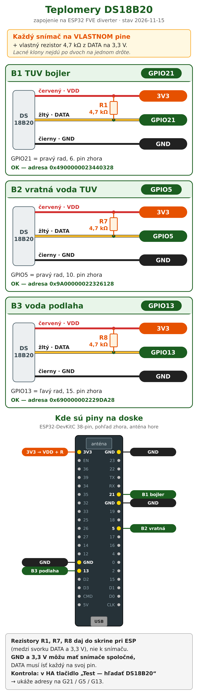
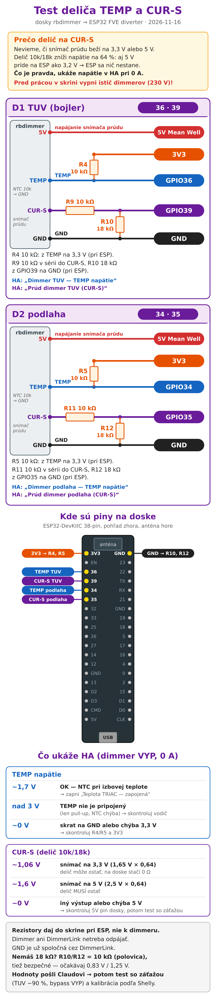

# Schémy

## Na mobil (na výšku, veľké písmo)

### Teplomery DS18B20 — každý na vlastnom pine

B1 bojler GPIO21 + R1 · B2 vratná GPIO5 + R7 · B3 podlaha GPIO13 + R8 (každý 4,7 kΩ z DATA na 3,3 V).
Generátor: `gen_mobil_teplomery.py`.

### Test deliča — TEMP a CUR-S dosiek rbdimmer (2026-11-16)

TEMP: R4/R5 10 kΩ z TEMP na 3,3 V (TUV G36, podlaha G34). CUR-S: delič R9/R11 10 kΩ v sérii +
R10/R12 18 kΩ na GND (TUV G39, podlaha G35) — bezpečné pri snímači na 3,3 V aj 5 V; pokojové
napätie v HA (0 A) ukáže, ktoré to je. Generátor: `gen_mobil_test_delica.py`.

## Veľké schémy (na PC / tlač)

| Súbor | Obsah |
|---|---|
| [`esp32_pinout_zapojenie.png`](esp32_pinout_zapojenie.png) | doska ESP32, čo je na ktorom pine |
| [`esp32_schema_realny.png`](esp32_schema_realny.png) | riadiaca časť (STN/IEC značky) |
| [`fve_schema_riadenie.png`](fve_schema_riadenie.png) | prehľad ESP32 vstupy/výstupy |
| [`fve_schema_realny.png`](fve_schema_realny.png) | silová časť |
| [`fve_schema.png`](fve_schema.png) | celý prehľad (+ `_zapojenie`, `_dimmer_detail`) |

PNG sa generujú zo `gen_*.py` (`python3 gen_….py`, potrebuje `rsvg-convert`).
